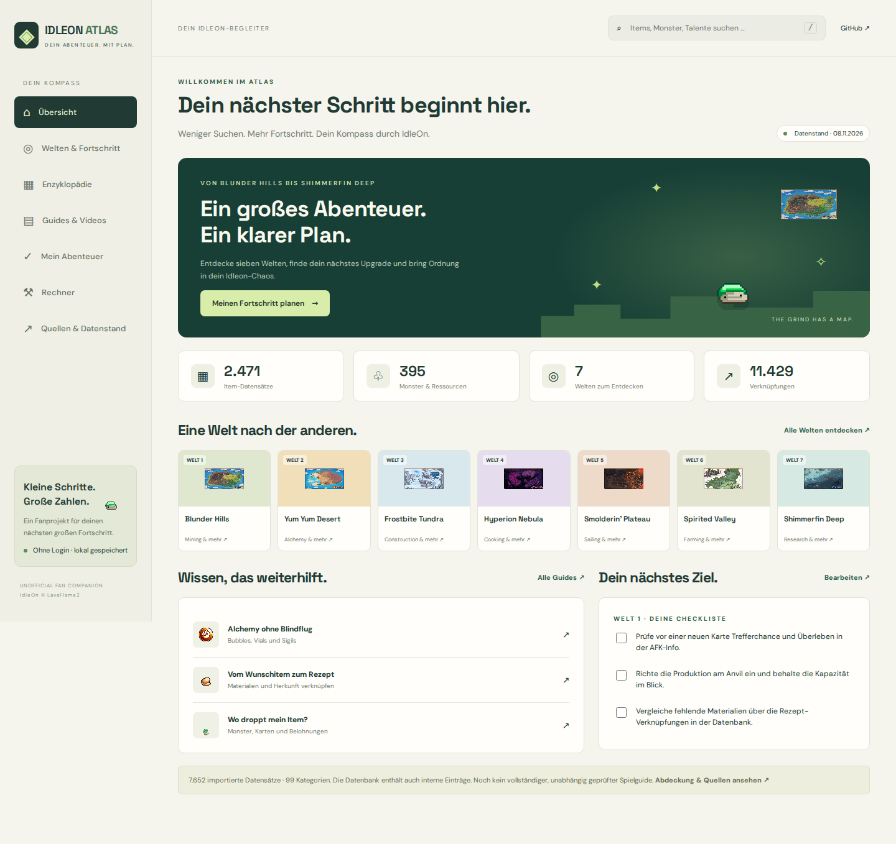

# Idleon Atlas

Deutsche Guide-App für Legends of IdleOn: Android-APK mit vollständig eingebauten Offline-Daten und zusätzliche Web-Version. Ein unabhängiges Fanprojekt für Ubrig.

**Stand 08.11.2026: spielbare erste App-Version, kein vollständiges oder lückenlos verifiziertes IdleOn-Nachschlagewerk.**

## Android installieren

Unter [Releases](https://github.com/marceldubrig-hash/Idleon-Guide/releases) die Datei **Idleon-Atlas-Android.apk** herunterladen und auf Android öffnen. Falls Android fragt, die Installation für den verwendeten Browser erlauben. Ein ZIP aus GitHub Actions ist dafür nicht nötig.

Die Android-Version verwendet die Atlas-Oberfläche in einer lokalen WebView. Keine Website muss gehostet werden. Bildschirmränder, Zurücknavigation und Backup-Dateiauswahl sind nativ integriert. Die APK enthält alle Daten und Grafiken. Eine aktuelle Android System WebView wird vorausgesetzt.

APK-Build: `npm run build && node scripts/prepare-android.mjs`, danach `gradle -p android assembleRelease` (Gradle 8.11.1, JDK 17, Android SDK 35). Der Workflow **Android APK** baut, prüft im Emulator und veröffentlicht den direkten APK-Download.

[Hinweise zur Vorschau und Signierung](docs/ANDROID_RELEASE.md). Ein dauerhafter Produktionsschlüssel ist noch nicht eingerichtet.

## Enthalten

- 7.652 durchsuchbare Entitäten in 99 Kategorien, einschließlich interner Datensätze.
- 11.429 Verknüpfungen für Drops, Rezepte, NPCs, Quests, Karten, Klassen, Talente und mehr.
- Sieben Weltübersichten, 16 deutsche Orientierungs-/Praxisguides und fünf GriffyBit-Videoverweise.
- 6.489 lokal gespeicherte Grafiken, Herkunftsmanifest und pinned Upstream-Commit.
- Merkliste, persistente Checklisten, lokale Weltwahl, JSON-Backup und Import.
- Basis-Rezeptrechner mit rekursiver Materialauflösung, Drop-Wahrscheinlichkeit und Zeitrechner.
- Offline-App-Grundgerüst mit Service Worker. Grafiken werden beim Aufruf gecacht; nicht alle Bilder sind sofort offline verfügbar.
- Vollständige zusätzliche JSON-Spieltabellen als Downloads. Nicht jedes Tabellenfeld hat schon eine eigene Oberfläche.

Spielnamen und Originalbeschreibungen bleiben englisch; Oberfläche und redaktionelle Guides sind deutsch. Variable Effekte werden als `[Levelwert]` markiert und nicht als tatsächlicher Accountwert ausgegeben. Die Rohformeln sind einsehbar.

## Lokal starten

Node.js 24, Python 3 nur für Datenimporte. Beim ersten CI-Lauf werden der fest versionierte Datenbestand und die Grafiken importiert und als eigener Commit in diesem Repo gespeichert. Die App selbst hat keine Runtime-NPM-Abhängigkeiten.

```sh
npm ci
npm test
npm run build
npm start
```

Öffne `http://localhost:4173`. Entwicklung: `npm run dev`.

Browsertests: `npx playwright install chromium` und `npx playwright test` nach dem Build. GitHub Actions führt Unit-, Daten- und Browsertests aus und stellt Screenshots und die fertige App als Artefakte bereit.

## GitHub Pages

In Repository **Settings → Pages → Source: GitHub Actions** auswählen. Danach den Workflow **Publish GitHub Pages** manuell ausführen. Erst nach erfolgreichem Deployment ist die App unter der von GitHub ausgegebenen URL erreichbar. Kein Backend, keine Schlüssel und kein Spiel-Login erforderlich.

Die relative Pfadstruktur unterstützt das Unterverzeichnis `/Idleon-Guide/`.

## Quellen und ehrliche Grenzen

Primäre importierte Daten: [Morta1/IdleonToolbox](https://github.com/Morta1/IdleonToolbox), Commit `2dd523b8f3e41a586e7b56713f065f3bce97358d`, GPL-3.0-only. Der komplette Entitätsgraph und die strukturierten Spieltabellen wurden übernommen; keine Account-Saves oder Testprofile.

- Offizielles Wiki: Abruf blockiert; direkte Suche verlinkt, **nicht vollständig abgeglichen**.
- Reddit: öffentliche Ressourcenübersicht gelesen und zur Quellenfindung genutzt; keine flächendeckende Auswertung.
- GriffyBit: ausgewählte Videos verlinkt, **keine vollständige Sichtung oder Transkriptauswertung**.
- Discord: öffentliche Einladungen verlinkt; **keine Servernachrichten gelesen**.
- Optimale Builds, detaillierte Bossstrategien, aktuelle Eventrouten und eine individuelle Accountanalyse sind **noch offen**.
- Ein vollständiger Import eines Community-Datenbestands bedeutet nicht, dass sämtliche Spielinhalte enthalten oder aktuell sind.

Siehe [docs/COVERAGE.md](docs/COVERAGE.md), die Quellenansicht in der App sowie `public/data/provenance.json`.

## Reproduzierbarer Datenimport

```sh
git clone https://github.com/Morta1/IdleonToolbox.git ../idleon-toolbox
git -C ../idleon-toolbox checkout 2dd523b8f3e41a586e7b56713f065f3bce97358d
python3 scripts/import-data.py ../idleon-toolbox
python3 scripts/create-guides.py
npm test
npm run build
```

Der Import ist bewusst manuell, damit Updates geprüft werden können. Bei einem neuen Snapshot Importdatum, Quellenstatus und Service-Worker-Version aktualisieren.

## Rechte

Eigener App-Code und übernommener Toolbox-Datenbestand: GPL-3.0-only, siehe [LICENSE](LICENSE). Attribution und Unterschiede: [THIRD_PARTY_NOTICES.md](THIRD_PARTY_NOTICES.md). IdleOn-Spielgrafiken und Marken bleiben Eigentum ihrer Rechteinhaber, insbesondere LavaFlame2. Die GPL für den App-Code ist keine zusätzliche Lizenz für Spielgrafiken. Kein offizielles IdleOn-Produkt.

## Vorschau und Prüfung



[Mobile Ansicht](docs/screenshots/mobile.png) · [Prüfbericht](docs/VALIDATION.md) · [Erfolgreicher Build mit App-Download](https://github.com/marceldubrig-hash/Idleon-Guide/actions/runs/42530900295)
