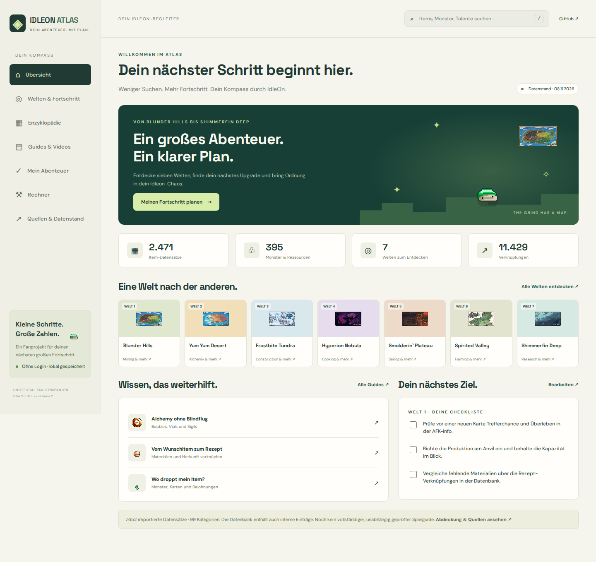

# Validation · 2026-11-08

Successful CI: https://github.com/marceldubrig-hash/Idleon-Guide/actions/runs/42530900295

- 7 data/calculation tests passed: graph references, local icons, search filters, adjacency, probability edge cases, recursive recipes and import metadata.
- 5 Playwright browser tests passed: search/detail/bookmarks/persistence; recipe/drop calculators; main routes without JS errors; responsive widths 390/768/1440; offline app/data after service worker installation.
- Production build succeeded. The downloadable `idleon-atlas-web-app` artifact contains the built app and assets.
- Desktop and mobile home screenshots visually reviewed. Screenshot evidence is committed alongside this report.
- Native Fold/Android testing and actual home-screen installation have not been performed.
- GitHub Pages deployment workflow is prepared but has NOT been executed or claimed live. The repository owner must enable Pages (Source: GitHub Actions) before running it; the available connector does not expose Pages administration.
- Initial CI failure was an Ubuntu 26 / Playwright compatibility issue; pinning ubuntu-24.04 fixed it. Local browser startup was restricted, so browser validation was performed successfully on GitHub Actions.

[Mobile screenshot](screenshots/mobile.png)
